<picture>
  <source media="(prefers-color-scheme: dark)" srcset="public/branding/meplan-logo-full-dark.svg" />
  <source media="(prefers-color-scheme: light)" srcset="public/branding/meplan-logo-full-light.svg" />
  
</picture>

# ✨ MEPlan — My Event Planner
### **All-in-One Event Readiness Tracker, VIP Guest CRM & Editorial Digital Invitation Suite**

  <strong>🌐 Bilingual Ready (Bahasa Indonesia &amp; English)</strong> &bull;
  <strong>💎 5 Kategori Acara</strong> &bull;
  <strong>🎨 5 Palet Tema Dinamis</strong> &bull;
  <strong>🔗 Direct Hash Link (<code>/[hash]</code>)</strong>

---

[**🚀 Buka Live Platform**](https://meplanner.vercel.app) &nbsp;&bull;&nbsp;
[**✨ Katalog & Simulasi Interaktif**](https://meplanner.vercel.app/#showcase) &nbsp;&bull;&nbsp;
[**💎 Paket Lisensi**](https://meplanner.vercel.app/#paket) &nbsp;&bull;&nbsp;
[**👨‍💻 Profil Developer (@omeko42)**](https://github.com/omeko42)

---

## 🏛️ Ringkasan Eksekutif (Overview)

**MEPlan (My Event Planner)** adalah platform SaaS komersial **All-in-One Event Readiness Tracker, VIP Guest CRM, & Undangan Digital Editorial** yang dirancang untuk menangani **5 kategori acara utama**:
1. 💍 **Pernikahan (*Wedding Celebration*)**
2. 🎂 **Ulang Tahun (*Birthday Milestone*)**
3. 🎓 **Wisuda & Syukuran (*Graduation Ceremony*)**
4. 🏛️ **Rapat & Agenda Eksekutif (*Corporate / Official Meeting*)**
5. 🥂 **Gala Dinner & Penghargaan (*VIP Gala & Award Night*)**

Melalui satu ekosistem *cloud* terpadu, tuan rumah penyelenggara bersama tim **Event / Wedding Organizer (EO/WO)** dapat merancang undangan digital sinematik, menyebarkan tautan personal berbasis **21-Character Direct Hash URL (`/[hash]`)** lengkap dengan **Pratinjau Gambar Hero Otomatis di WhatsApp (*Dynamic OpenGraph*)**, sekaligus memantau kesiapan teknis dan anggaran acara secara *real-time*.

---

## 🧩 Arsitektur 3-Surface Terpadu

```mermaid
flowchart LR
  subgraph S1["🌐 1. Commercial SaaS Catalog"]
    C1["Landing Page & Brand Showcase"]
    C2["Simulasi Undangan & Planner 1:1"]
    C3["Multi-Currency Checkout & Invoice"]
  end

  subgraph S2["🎨 2. Event Planner Workspace"]
    P1["Executive Readiness Tracker"]
    P2["Checklist Lintas Fase (H-6 Bln s/d Hari-H)"]
    P3["Kalkulator Pagu Moneter & Kontrak Vendor"]
    P4["CRM Tamu VIP & Generator WA 1-Klik"]
    P5["Studio Konten, Media & 5 Palet Tema"]
  end

  subgraph S3["💌 3. Public Digital Invitation"]
    I1["Direct Hash Link (/[hash]) + OG Hero Preview"]
    I2["Adaptive Video (9:16 ↔ 16:9) & Multi-Slide"]
    I3["NCS Royalty-Free + Spotify/YouTube Embed"]
    I4["Real-Time RSVP, Buku Tamu & Amplop Digital"]
  end

  DB[("☁️ Supabase Cloud DB\n+ Object Storage\n+ Google Sheets Sync")]

  S1 --> S2
  S2 <--> DB
  DB <--> S3
```

| Surface | Identitas Visual | Fungsi Utama |
| :--- | :--- | :--- |
| **1. Website Katalog (`CommercialLandingView`)** | **MEPlan SaaS Midnight Navy & Indigo** | Menampilkan simulasi interaktif 1:1 (`<PublicInvitationView />` & `<AdminDashboardView />` asli dengan 5 klien *dummy* terpisah), perbandingan paket lisensi, dan *checkout* multi-valuta (`IDR`, `USD`, `USDT`). |
| **2. Workspace Planner (`AdminDashboardView`)** | **Dinamis Mengikuti Palet Tema Undangan** | Ruang kerja kolaboratif untuk memantau kesiapan acara, *checklist* tugas, kontrak vendor & anggaran, manajemen tamu VIP, hingga kustomisasi penuh isi & visual undangan. |
| **3. Undangan Publik (`PublicInvitationView`)** | **Editorial Luxury & 5 Palet Tema Klien** | Halaman undangan tamu dengan animasi *curtain-lift*, *feathered hero banner*, hitung mundur sesi utama, galeri HD, musik NCS/Spotify/YouTube, form RSVP, dan amplop digital. |

---

## 🎨 5 Kategori Acara & 5 Palet Tema Tersinkronisasi

Setiap perubahan **Palet Tema Warna** di dalam **Planner (`Pengaturan -> Tema & Latar`)** secara otomatis mengubah suasana warna di **Workspace Planner** sekaligus seluruh ornamen bunga sudut, partikel kelopak melayang, *veil overlay*, bingkai foto, kartu acara, dan tombol di **Undangan Publik**:

| Kategori Acara | Palet Tema Unggulan | Karakter Visual | Aksentuasi Warna Utama |
| :--- | :--- | :--- | :--- |
| 💍 **Pernikahan (*Wedding*)** | **Champagne Gold** | Klasik Mewah & Hangat | `#D4AF37` &bull; `#C5A059` &bull; `#8B6914` &bull; `#FAF3E3` |
| 🎂 **Ulang Tahun (*Birthday*)** | **Blush Rose** | Romantis Pink & Ivory | `#D88290` &bull; `#C86D7C` &bull; `#8E3546` &bull; `#FCECEF` |
| 🎓 **Wisuda (*Graduation*)** | **Royal Navy** | Biru Malam & Elegan | `#3B669E` &bull; `#284B7A` &bull; `#162F50` &bull; `#EBF1F8` |
| 🏛️ **Rapat Resmi (*Meeting*)** | **Sage Botanical** | Hijau Taman & Organik | `#5E8C6A` &bull; `#4A6B53` &bull; `#23422C` &bull; `#EBF3ED` |
| 🥂 **Gala Dinner (*VIP Gala*)** | **Terracotta Rust** | Earthy Hangat & Rustik | `#CC704E` &bull; `#B85D3B` &bull; `#7D341A` &bull; `#F9EBE4` |

---

## 🚀 6 Modul Unggulan Platform

### 1. 🔗 Direct Hash Guest Link (`/[hash]`) & Dynamic WhatsApp OpenGraph
- Setiap tamu yang ditambahkan ke dalam CRM otomatis mendapatkan **21-Character Base62 Hash Unik** (contoh: `https://meplanner.vercel.app/DvVsH3CprCb3URDzq8Tmz`) tanpa perlu mengekspos parameter panjang di URL.
- Dilengkapi **Server-Side Dynamic OpenGraph Metadata** yang mengambil *Hero Banner* terbaru langsung dari Supabase Cloud, sehingga saat link dikirim via WhatsApp, gambar *banner* acara dan judul personalisasi tamu langsung tampil otomatis.

### 2. 🎬 Studio Media 3-Bagian & Musik Bebas Klaim (NCS + Spotify / YouTube)
- **3 Slot Media Independen:** Pengaturan latar terpisah untuk **1. Sampul Depan (*Cover*)**, **2. Banner Hero**, dan **3. Wallpaper Latar** — masing-masing mendukung foto tunggal, *multi-photo smooth slideshow* (*Crossfade, Zoom & Blur, Smooth Slide*), maupun **Video Latar Adaptif s/d 25 MB** (otomatis menyesuaikan layar HP `9:16` ke PC `16:9`).
- **Smart Audio Engine:** Menyediakan katalog instrumen bawaan **NCS (*NoCopyrightSounds*)** bebas klaim hak cipta, integrasi **Embed Resmi Spotify & YouTube**, serta dukungan *upload* MP3 kustom.

### 3. 📊 Executive Readiness Tracker & Multi-Session Countdown
- Menampilkan KPI kesiapan acara secara *real-time*, progres penyelesaian tugas lintas divisi, rekapitulasi kehadiran RSVP & total kuota *pax*, serta hitung mundur otomatis menuju sesi **Acara Utama**.

### 4. ✅ Checklist Persiapan Lintas Fase & RBAC Multi-Akses
- Pembagian tugas terstruktur mulai dari **H-6 Bulan, H-3 Bulan, H-1 Bulan, H-7, hingga Hari-H** lengkap dengan filter prioritas dan penanggung jawab (*PIC*).
- **Role-Based Access Control (RBAC):** Memisahkan hak akses antara **Akun Inti Penyelenggara** (akses penuh termasuk modul Moneter) dan **Akun Panitia / EO / WO** (fokus operasional & tamu tanpa melihat rincian finansial).

### 5. 💰 Kalkulator Pagu Moneter & Kontrak Vendor
- Pelacakan pagu anggaran vs realisasi kontrak vendor, status pembayaran (*Belum Bayar, DP Terbayar, Cicilan, Lunas*), serta bukti lampiran pembayaran.

### 6. 💳 Amplop Digital Multi-Valuta & Pengiriman Kado Fisik
- Mendukung **Transfer Bank Nasional**, **QRIS Barcode**, **E-Wallet**, **PayPal Internasional**, dan **Cryptocurrency (`USDT` TRC20 / ERC20)** dalam kartu berdesain *Metallic EMV Chip* lengkap dengan tombol salin 1-klik.

---

## 🖼️ Pratinjau Modul Planner (Workspace Modules)

| **1. Executive Readiness Tracker** | **2. Timeline Checklist & PIC** |
| :---: | :---: |
|  |  |
| **3. Kalkulator Pagu Moneter & Vendor** | **4. CRM Tamu VIP & Generator WA 1-Klik** |
|  |  |

  
<strong>5. Studio Kustomisasi Konten, 5 Palet Tema &amp; 3 Bagian Media Latar</strong>

  

---

## 💎 Paket Lisensi Komersial (IDR & Global USD/USDT)

| Paket Lisensi | Harga Promo (IDR) | Harga Global (USD / USDT) | Kapasitas & Fasilitas Utama |
| :--- | :---: | :---: | :--- |
| **🥉 STARTER** | **Rp 50.000** *(Normal ~~Rp 150.000~~)* | **$10 USD / 10 USDT** | &bull; Kuota s/d **100 Tamu Undangan** + Link Hash Unik (`/[hash]`) &bull; 3 Slot Foto Latar Statis + 5 Pilihan Palet Tema Warna &bull; Hitung Mundur, Jadwal Acara, Google Maps & Simpan Kalender &bull; Form RSVP Real-Time, Buku Tamu & Amplop Digital Domestik (Bank & QRIS) &bull; Workspace Planner Dasar (Tracker, Checklist & Tabel Tamu) &bull; **Aktif 3 Bulan** |
| **🥈 EXCLUSIVE** *(Best Seller)* | **Rp 299.000** *(Normal ~~Rp 600.000~~)* | **$25 USD / 25 USDT** | &bull; **Seluruh Fitur STARTER** + Kuota s/d **500 Tamu VIP & Blast WA 1-Klik** &bull; **Multi-Foto Smooth Slideshow** (*Crossfade, Zoom & Blur, Smooth Slide*) + Studio Crop &bull; Seksi Kisah Perjalanan, Galeri Foto HD & Musik Latar (NCS / Spotify / YouTube) &bull; Amplop Digital Lengkap (Bank, QRIS, E-Wallet & Alamat Kado Fisik) &bull; **Buka Modul Moneter, Pagu Anggaran & Kontrak Vendor** + 2 Akun Inti &bull; **Aktif 6 Bulan** |
| **👑 ROYAL VIP** *(Flagship Suite)* | **Rp 599.000** *(Normal ~~Rp 1.200.000~~)* | **$49 USD / 49 USDT** | &bull; **Seluruh Fitur EXCLUSIVE** + **Unlimited Tamu & Pax Tanpa Batas** &bull; **Video Background Sinematik s/d 25 MB** (*Auto-Stretch HP 9:16 ↔ PC 16:9*) &bull; Unlimited Galeri Foto HD, Upload Musik MP3 Kustom & Bilingual ID/EN &bull; **Amplop Digital Global Multi-Valuta** (Bank, QRIS, PayPal & Crypto USDT) &bull; **4 Akun Inti Penyelenggara + Unlimited Akun Panitia / EO / WO** &bull; Sinkronisasi Supabase Cloud, Google Sheets & Backup JSON &bull; **Aktif 12 Bulan** |

---

## 🛠️ Teknologi & Infrastruktur (Tech Stack)

- **Framework & UI:** Next.js 15 (App Router, Server Metadata & Dynamic Routes `/[hash]`), React 19, TypeScript 5, Tailwind CSS, Lucide Icons.
- **Cloud Database & Storage:** Supabase PostgreSQL (`public.wedding_state` JSONB Sync) + Supabase Storage (`wedding-media` WebP Auto-Compression & Video Streaming) + Local IndexedDB Resilience.
- **Integrasi Eksternal:** Google Sheets Apps Script Webhook, WhatsApp Deep-Link Generator, Official Spotify & YouTube Embed API, Web3 Wallet & On-Chain Transaction Verifier (`TRON TRC20`, `EVM ERC20/BEP20`), PayPal Smart Checkout, & QRIS Nasional.

---

## 👨‍💻 Developer & Kontak Resmi

Dirancang, dikembangkan, dan dikelola secara penuh oleh:

- 👤 **Nama Lengkap:** **Eko Agung Krisdianto**
- 🐙 **GitHub:** [**@omeko42**](https://github.com/omeko42)
- 💼 **LinkedIn:** [**Eko Agung Krisdianto**](https://www.linkedin.com/in/eko-agung-krisdianto-408955130)
- 🌐 **Official Repository:** [**github.com/omeko42/meplanner**](https://github.com/omeko42/meplanner)

---

  &copy; 2026 <strong>MEPlan — My Event Planner</strong> by <a href="https://github.com/omeko42"><strong>@omeko42</strong></a>. All Rights Reserved.

