<picture>
  <source media="(prefers-color-scheme: dark)" srcset="public/branding/meplanner-logo-full-dark.svg" />
  <source media="(prefers-color-scheme: light)" srcset="public/branding/meplanner-logo-full-light.svg" />
  
</picture>

# ✨ MEPlanner — My Event Planner
### **All-in-One Event Readiness Tracker, VIP Guest CRM & Editorial Digital Invitation Suite**

  <strong>🌐 100% Bilingual (Bahasa Indonesia &amp; English)</strong> &bull;
  <strong>💎 5 Kategori Acara</strong> &bull;
  <strong>🎨 25 Tema Eksklusif &amp; 5 Layout Archetype</strong> &bull;
  <strong>⚡ Instant Edge OpenGraph (<code>/[hash]</code>)</strong>

---

[**🚀 Buka Live Platform**](https://meplanner.vercel.app) &nbsp;&bull;&nbsp;
[**✨ Katalog & Simulasi Interaktif**](https://meplanner.vercel.app/#showcase) &nbsp;&bull;&nbsp;
[**💎 Informasi Paket & Lisensi**](https://meplanner.vercel.app/#paket) &nbsp;&bull;&nbsp;
[**👨‍💻 Profil Developer (@omeko42)**](https://github.com/omeko42)

---

## 🏛️ Ringkasan Eksekutif (Overview)

**MEPlanner (My Event Planner)** adalah platform SaaS **All-in-One Event Readiness Tracker, VIP Guest CRM, & Undangan Digital Editorial** yang dirancang untuk menangani **5 kategori acara utama**:
1. 💍 **Pernikahan (*Wedding Celebration*)** — 10 Tema Eksklusif
2. 🎂 **Ulang Tahun (*Birthday Milestone*)** — 4 Tema Eksklusif
3. 🎓 **Wisuda & Syukuran (*Graduation Ceremony*)** — 4 Tema Eksklusif
4. 🏛️ **Rapat & Agenda Eksekutif (*Corporate / Official Meeting*)** — 4 Tema Eksklusif
5. 🥂 **Gala Dinner & Penghargaan (*VIP Gala & Award Night*)** — 3 Tema Eksklusif

Melalui satu ekosistem *cloud* terpadu, penyelenggara acara bersama tim **Event / Wedding Organizer (EO/WO)** dapat merancang undangan digital berstandar editorial, menyebarkan tautan personal berbasis **21-Character Direct Hash URL (`/[hash]`)** lengkap dengan **Pratinjau Thumbnail Otomatis di WhatsApp (< 20ms Edge OpenGraph)**, mengoperasikan **Layar Penerima Tamu (QR Check-In)** di lokasi acara, serta memantau kesiapan tugas dan anggaran vendor secara *real-time*.

---

## 🧩 Arsitektur 3-Surface Terpadu

```mermaid
flowchart LR
  subgraph S1["🌐 1. Commercial SaaS Catalog"]
    C1["Landing Page & Brand Showcase"]
    C2["Simulasi 25 Tema & Planner 1:1"]
    C3["Multi-Channel Checkout & Aktivasi"]
  end

  subgraph S2["🎨 2. Event Planner Workspace"]
    P1["Executive Readiness Tracker"]
    P2["Checklist Lintas Fase (H-6 Bln s/d Hari-H)"]
    P3["Kalkulator Pagu Moneter & Kontrak Vendor"]
    P4["CRM Tamu VIP, Blast WA & Layar QR Check-In"]
    P5["Studio Konten, Media & Enforcement Paket"]
  end

  subgraph S3["💌 3. Public Digital Invitation"]
    I1["Direct Hash Link (/[hash]) + Instant Edge OG"]
    I2["5 Layout Archetypes & 25 Curated Themes"]
    I3["NCS Royalty-Free + Spotify/YouTube Embed"]
    I4["Real-Time RSVP, Buku Tamu & Amplop Digital"]
  end

  DB[("☁️ Supabase Cloud DB\n+ Object Storage\n+ Google Sheets Sync")]

  S1 --> S2
  S2 <--> DB
  DB <--> S3
```

| Surface | Identitas Visual | Fungsi Utama |
| :--- | :--- | :--- |
| **1. Website Katalog (`CommercialLandingView`)** | **MEPlanner SaaS Pearl Light & Indigo** | Menampilkan simulasi interaktif 1:1 (`<PublicInvitationView />` & `<AdminDashboardView />` asli dengan 25 preset tema & 5 klien *showcase* terpisah), perbandingan spesifikasi paket lisensi, dan aktivasi workspace instan. |
| **2. Workspace Planner (`AdminDashboardView`)** | **Dinamis Mengikuti Palet Tema Undangan** | Ruang kerja kolaboratif untuk memantau kesiapan acara, *checklist* tugas, kontrak vendor & anggaran, manajemen tamu VIP, meja penerima tamu QR Check-In, hingga kustomisasi penuh isi & visual undangan. |
| **3. Undangan Publik (`PublicInvitationView`)** | **Editorial Luxury, 5 Palet & 5 Layout Archetype** | Halaman undangan tamu bertema terang (*light luxury*) dengan 5 arsitektur tata letak (`EDITORIAL_CLASSIC`, `POLAROID_MAGAZINE`, `BOTANICAL_AIRY`, `NUSANTARA_HERITAGE`, `MODERN_BENTO`), *feathered hero banner*, hitung mundur sesi utama, galeri HD, musik NCS/Spotify/YouTube, form RSVP, QR E-Ticket, dan amplop digital. |

---

## 🎨 5 Kategori Acara, 25 Tema Kurasi & 5 Palet Warna Tersinkronisasi

Setiap pemilihan **Tema & Palet Warna** secara otomatis menyelaraskan nuansa warna di **Workspace Planner** sekaligus seluruh ornamen sudut (`Corner Cluster`), partikel kelopak melayang, *veil overlay*, bentuk bingkai foto (`ARCH_DOME`, `CIRCLE`, `EDITORIAL_RECT`, `OVAL_CLASSIC`), arsitektur tata letak (`layoutArchetype`), kartu acara, dan tombol di **Undangan Publik**:

| Kategori Acara | Palet Tema Unggulan | Koleksi 25 Tema Eksklusif (`MEPLANNER_THEME_PRESETS`) | Aksentuasi Warna Utama |
| :--- | :--- | :--- | :--- |
| 💍 **Pernikahan (*Wedding*)** | **Champagne Gold** | `Timeless Snapshot`, `Serein`, `Mildness`, `Culture: Javanese Kraton`, `Wayang Heritage Gold`, `BluBloom`, `Pearl & Ivory Elegance`, `Espresso & Simple Rustic`, `Photovit: Black & Green`, `Peppy & Visual Journey` | `#D4AF37` &bull; `#C5A059` &bull; `#8B6914` &bull; `#FAF3E3` |
| 🎂 **Ulang Tahun (*Birthday*)** | **Blush Rose** | `Sweet 17th Rose Soirée`, `Peppy Confetti Milestone`, `Golden Jubilee 50th`, `Botanical Garden Soirée` | `#D88290` &bull; `#C86D7C` &bull; `#8E3546` &bull; `#FCECEF` |
| 🎓 **Wisuda (*Graduation*)** | **Royal Navy** | `Cum Laude Academic Gold`, `Sumpah Dokter & Profesi`, `Royal Alma Mater Navy`, `Modern Scholar Terracotta` | `#3B669E` &bull; `#284B7A` &bull; `#162F50` &bull; `#EBF1F8` |
| 🏛️ **Rapat Resmi (*Meeting*)** | **Sage Botanical** | `Executive Summit & Rakornas`, `State & Ministry Protocol`, `Green ESG & Sustainability Forum`, `Digital Transformation Keynote` | `#5E8C6A` &bull; `#4A6B53` &bull; `#23422C` &bull; `#EBF3ED` |
| 🥂 **Gala Dinner (*VIP Gala*)** | **Terracotta Rust** | `Royal Sapphire Award Night`, `Champagne Gold Orchestra Gala`, `Velvet Charity & Appreciation Night` | `#CC704E` &bull; `#B85D3B` &bull; `#7D341A` &bull; `#F9EBE4` |

---

## 🚀 8 Keunggulan Teknis & Operasional

### 1. ⚡ Instant Edge OpenGraph (`/[hash]`) & Pratinjau Thumbnail WhatsApp
- Setiap tamu di dalam CRM otomatis memiliki **21-Character Base62 Hash Unik** (`https://meplanner.vercel.app/<hash>`).
- Dilengkapi **Edge Middleware OpenGraph Responder (`src/middleware.ts`)** dan **Static CDN Pre-rendering (`generateStaticParams`)** yang merespons bot WhatsApp, Telegram, Line, dan media sosial dalam **< 20ms**, sehingga *thumbnail* foto acara (1200×630 JPEG), judul acara, dan nama lengkap tamu kehormatan langsung tampil otomatis saat tautan dibagikan.

### 2. 🖥️ Proporsi Layar Adaptif (`1920×1080` Reference Scaling) & 100% Bilingual (`ID` / `EN`)
- **Adaptive Viewport Scaling:** Dirancang dengan acuan skala 100% pada monitor PC Full HD (`1920×1080`) yang otomatis menyesuaikan proporsi (*auto-scale/shrink*) pada layar laptop/monitor yang lebih sempit atau lebih lebar, serta responsif penuh di berbagai ukuran layar smartphone.
- **Lokalisasi Penuh 2 Bahasa (`ID` & `EN`):** Seluruh antarmuka halaman katalog komersial, halaman undangan publik, kartu acara, hitung mundur, form RSVP, amplop digital, hingga modal autentikasi mendukung pergantian Bahasa Indonesia (`ID`) dan Bahasa Inggris (`EN`) secara konsisten.

### 3. 🎫 Layar Penerima Tamu (Guest Reception Screen) & QR E-Ticket Check-In
- Setiap tamu undangan digital yang melakukan konfirmasi kehadiran mendapatkan **QR E-Ticket Pass** personal.
- Panitia di lokasi acara dapat membuka modul **Layar Penerima Tamu** untuk melakukan *scan* / input kode tiket tamu, mencatat waktu kehadiran (*Hadir di Lokasi*), serta menampilkan layar sapaan penyambutan tamu secara langsung.

### 4. 🎬 Studio Media 3-Bagian & Musik Bebas Klaim (NCS + Spotify / YouTube)
- **3 Slot Media Independen:** Pengaturan latar terpisah untuk **1. Sampul Depan (*Cover*)**, **2. Banner Hero**, dan **3. Wallpaper Latar** — mendukung foto tunggal, *multi-photo smooth slideshow* (*Crossfade, Zoom & Blur, Smooth Slide*), maupun **Video Latar Adaptif s/d 25 MB** (`9:16` ↔ `16:9`).
- **Smart Audio Engine:** Menyediakan koleksi instrumen **NCS (*NoCopyrightSounds*)** bebas klaim hak cipta, integrasi **Embed Resmi Spotify & YouTube**, serta dukungan *upload* MP3 kustom.

### 5. 📊 Executive Readiness Tracker & Multi-Session Countdown
- Menampilkan KPI kesiapan acara secara *real-time*, progres penyelesaian tugas lintas divisi, rekapitulasi kehadiran RSVP & total kuota *pax*, serta hitung mundur otomatis menuju sesi **Acara Utama**.

### 6. ✅ Checklist Persiapan Lintas Fase & RBAC Multi-Akses
- Pembagian tugas terstruktur mulai dari **H-6 Bulan, H-3 Bulan, H-1 Bulan, H-7, hingga Hari-H** lengkap dengan filter prioritas dan penanggung jawab (*PIC*).
- **Role-Based Access Control (RBAC):** Memisahkan hak akses antara **Akun Inti Penyelenggara** (akses penuh termasuk modul Moneter) dan **Akun Panitia / EO / WO** (fokus operasional & tamu tanpa mengekspos rincian finansial).

### 7. 💰 Kalkulator Pagu Moneter & Kontrak Vendor
- Pelacakan pagu anggaran vs realisasi kontrak vendor, status pembayaran (*Belum Bayar, DP Terbayar, Cicilan, Lunas*), serta pengingat jatuh tempo pelunasan vendor.

### 8. 💳 Amplop Digital Multi-Valuta & Pengiriman Kado Fisik
- Mendukung **Transfer Bank Nasional**, **QRIS Barcode**, **E-Wallet**, **PayPal Internasional**, dan **Cryptocurrency (`USDT` TRC20 / BEP20)** dalam kartu berdesain *Metallic EMV Chip* lengkap dengan tombol salin 1-klik serta alamat pengiriman kado fisik.

---

## 🖼️ Pratinjau Modul Planner (Workspace Modules)

| **1. Executive Readiness Tracker** | **2. Timeline Checklist & PIC** |
| :---: | :---: |
|  |  |
| **3. Kalkulator Pagu Moneter & Vendor** | **4. CRM Tamu VIP & Generator WA 1-Klik** |
|  |  |

  
<strong>5. Studio Kustomisasi Konten, 5 Palet Tema &amp; 3 Bagian Media Latar</strong>

  

---

## 💎 Struktur Tingkatan Paket Lisensi (Tier Enforcement System)

Setiap tingkatan paket di **MEPlanner** menerapkan kapabilitas fitur dan kuota yang terintegrasi langsung di dalam sistem (*real system-enforced quotas & feature unlocks*). Untuk informasi detail lisensi dan aktivasi langsung, silakan kunjungi halaman resmi [**meplanner.vercel.app/#paket**](https://meplanner.vercel.app/#paket).

| Tingkatan Paket | Peruntukan Utama | Cakupan Kapasitas & Fitur Sistem |
| :--- | :--- | :--- |
| **🌱 Coba Dulu Gratis (Free Trial)** | Uji coba fitur dasar & eksplorasi awal | &bull; **1 Workspace Undangan Standar** + Event Planner Dasar (Masa aktif uji coba 14 hari) &bull; Kuota Tamu Terbatas (s/d 25 tamu), 5 Tema Dasar, Galeri Foto Dasar, Musik Latar NCS, RSVP & Buku Tamu |
| **🥉 Premium** | 1 Acara Personal (Aktif Selamanya) | &bull; **1 Workspace Undangan Premium** (Masa aktif selamanya) &bull; **Unlimited Kuota Tamu**, Akses Seluruh **25 Tema Eksklusif**, Foto & Video Gallery, Link Live Streaming, Amplop Digital / Cashless, **Layar Penerima Tamu (QR Check-In)**, & Template Story IG |
| **🥈 Business** | 2 Acara / Pasangan Multi-Lokasi | &bull; **2 Workspace Undangan Premium** dalam 1 Akun (Masa aktif selamanya) &bull; **Unlimited Kuota Tamu & Blast WA**, Multi-Photo Smooth Slideshow, Layar Penerima Tamu, RSVP Lanjutan, Open Registration, & **Full Event Planner (Checklist + Budget Vendor)** |
| **👑 Enterprise** | 5 Acara / Keluarga Besar & Korporat | &bull; **5 Workspace Undangan Premium** (Masa aktif selamanya) &bull; Unlimited Kuota Tamu, **Video Background Sinematik s/d 25 MB**, Statistik & Analitik Undangan, Amplop Digital Multi-Channel (Bank, QRIS, PayPal, Crypto USDT), & Layar Penerima Tamu |
| **🤝 Mitra - Silver** | Paket Agensi WO / EO (11 Undangan) | &bull; **11 Workspace Undangan Premium** untuk manajemen multi-klien (Masa aktif selamanya) &bull; Seluruh fitur Enterprise + **✨ Kustomisasi Teks Footer / Branding Nama WO & EO** |
| **🏆 Mitra - Gold** | Paket Agensi VIP (23 Undangan) | &bull; **23 Workspace Undangan Premium** untuk agensi skala penuh (Masa aktif selamanya) &bull; Seluruh fitur Mitra Silver + **👑 White-Label Penuh (Branding Teks & Logo Resmi WO/EO di Undangan Klien)** |

---

## 🛠️ Teknologi & Infrastruktur (Tech Stack)

- **Framework & UI:** Next.js 14 (App Router, Edge Middleware OpenGraph, Static & Dynamic Routes `/[hash]`), React 18, TypeScript 5, Tailwind CSS, Lucide Icons.
- **Cloud Database & Storage:** Supabase PostgreSQL (`public.wedding_state` JSONB + Relational Tables) + Supabase Storage (`wedding-media` WebP Auto-Compression & Video Streaming) + Local IndexedDB Resilience.
- **Integrasi Eksternal:** Google Sheets Apps Script Webhook, WhatsApp Deep-Link Generator, Official Spotify & YouTube Embed API, Web3 On-Chain Transaction Verifier (`TRON TRC20`, `BNB Smart Chain BEP20`), PayPal Checkout, & QRIS Nasional.

---

## 👨‍💻 Developer & Kontak Resmi

Dirancang, dikembangkan, dan dikelola secara penuh oleh:

- 👤 **Nama Lengkap:** **Eko Agung Krisdianto**
- ✉️ **Email Resmi Bisnis:** [**e98.bisnis@gmail.com**](mailto:e98.bisnis@gmail.com)
- 🐙 **GitHub:** [**@omeko42**](https://github.com/omeko42)
- 💼 **LinkedIn:** [**Eko Agung Krisdianto (@omeko42)**](https://www.linkedin.com/in/omeko42)
- 🌐 **Official Repository:** [**github.com/omeko42/meplanner**](https://github.com/omeko42/meplanner)

---

  &copy; 2026 <strong>MEPlanner — My Event Planner</strong> by <a href="https://github.com/omeko42"><strong>@omeko42</strong></a>. All Rights Reserved.

