<picture>
  <source media="(prefers-color-scheme: dark)" srcset="public/branding/meplan-logo-full-dark.svg" />
  <source media="(prefers-color-scheme: light)" srcset="public/branding/meplan-logo-full-light.svg" />
  
</picture>

# ✨ MEPlanner — My Event Planner
### **All-in-One Event Readiness Tracker, VIP Guest CRM & Editorial Digital Invitation Suite**

  <strong>🌐 Bilingual Ready (Bahasa Indonesia &amp; English)</strong> &bull;
  <strong>💎 5 Kategori Acara</strong> &bull;
  <strong>🎨 25 Tema Eksklusif &amp; 5 Palet Dinamis</strong> &bull;
  <strong>🔗 Direct Hash Link (<code>/[hash]</code>)</strong>

---

[**🚀 Buka Live Platform**](https://meplanner.vercel.app) &nbsp;&bull;&nbsp;
[**✨ Katalog & Simulasi Interaktif**](https://meplanner.vercel.app/#showcase) &nbsp;&bull;&nbsp;
[**💎 Paket Lisensi**](https://meplanner.vercel.app/#paket) &nbsp;&bull;&nbsp;
[**👨‍💻 Profil Developer (@omeko42)**](https://github.com/omeko42)

---

## 🏛️ Ringkasan Eksekutif (Overview)

**MEPlanner (My Event Planner)** adalah platform SaaS komersial **All-in-One Event Readiness Tracker, VIP Guest CRM, & Undangan Digital Editorial** yang dirancang untuk menangani **5 kategori acara utama**:
1. 💍 **Pernikahan (*Wedding Celebration*)** — 10 Tema Eksklusif
2. 🎂 **Ulang Tahun (*Birthday Milestone*)** — 4 Tema Eksklusif
3. 🎓 **Wisuda & Syukuran (*Graduation Ceremony*)** — 4 Tema Eksklusif
4. 🏛️ **Rapat & Agenda Eksekutif (*Corporate / Official Meeting*)** — 4 Tema Eksklusif
5. 🥂 **Gala Dinner & Penghargaan (*VIP Gala & Award Night*)** — 3 Tema Eksklusif

Melalui satu ekosistem *cloud* terpadu, tuan rumah penyelenggara bersama tim **Event / Wedding Organizer (EO/WO)** dapat merancang undangan digital sinematik, menyebarkan tautan personal berbasis **21-Character Direct Hash URL (`/[hash]`)** lengkap dengan **Pratinjau Gambar Hero Otomatis di WhatsApp (*Dynamic OpenGraph*)**, sekaligus memantau kesiapan teknis dan anggaran acara secara *real-time*.

---

## 🧩 Arsitektur 3-Surface Terpadu

```mermaid
flowchart LR
  subgraph S1["🌐 1. Commercial SaaS Catalog"]
    C1["Landing Page & Brand Showcase"]
    C2["Simulasi 25 Tema & Planner 1:1"]
    C3["Multi-Currency Checkout & Invoice"]
  end

  subgraph S2["🎨 2. Event Planner Workspace"]
    P1["Executive Readiness Tracker"]
    P2["Checklist Lintas Fase (H-6 Bln s/d Hari-H)"]
    P3["Kalkulator Pagu Moneter & Kontrak Vendor"]
    P4["CRM Tamu VIP & Generator WA 1-Klik"]
    P5["Studio Konten, Media & 5 Palet Tema"]
  end

  subgraph S3["💌 3. Public Digital Invitation"]
    I1["Direct Hash Link (/[hash]) + OG Hero Preview"]
    I2["Adaptive Video (9:16 ↔ 16:9) & Multi-Slide"]
    I3["NCS Royalty-Free + Spotify/YouTube Embed"]
    I4["Real-Time RSVP, Buku Tamu & Amplop Digital"]
  end

  DB[("☁️ Supabase Cloud DB\n+ Object Storage\n+ Google Sheets Sync")]

  S1 --> S2
  S2 <--> DB
  DB <--> S3
```

| Surface | Identitas Visual | Fungsi Utama |
| :--- | :--- | :--- |
| **1. Website Katalog (`CommercialLandingView`)** | **MEPlanner SaaS Pearl Light & Indigo** | Menampilkan simulasi interaktif 1:1 (`<PublicInvitationView />` & `<AdminDashboardView />` asli dengan 25 preset tema & 5 klien *dummy* terpisah), perbandingan paket lisensi, dan *checkout* multi-valuta (`IDR`, `USD`, `USDT`). |
| **2. Workspace Planner (`AdminDashboardView`)** | **Dinamis Mengikuti Palet Tema Undangan** | Ruang kerja kolaboratif untuk memantau kesiapan acara, *checklist* tugas, kontrak vendor & anggaran, manajemen tamu VIP, hingga kustomisasi penuh isi & visual undangan. |
| **3. Undangan Publik (`PublicInvitationView`)** | **Editorial Luxury, 5 Palet & 5 Layout Archetype** | Halaman undangan tamu bertema terang (*light luxury*) dengan 5 bentuk arsitektur tata letak (`EDITORIAL_CLASSIC`, `POLAROID_MAGAZINE`, `BOTANICAL_AIRY`, `NUSANTARA_HERITAGE`, `MODERN_BENTO`), *feathered hero banner*, hitung mundur sesi utama, galeri HD, musik NCS/Spotify/YouTube, form RSVP, dan amplop digital. |

---

## 🎨 5 Kategori Acara, 25 Tema Kurasi & 5 Palet Warna Tersinkronisasi

Setiap perubahan **Palet Tema Warna** di dalam **Planner (`Pengaturan -> Tema & Latar`)** secara otomatis mengubah suasana warna di **Workspace Planner** sekaligus seluruh ornamen bunga sudut, partikel kelopak melayang, *veil overlay*, bingkai foto (`ARCH_DOME`, `CIRCLE`, `EDITORIAL_RECT`), tata letak (`layoutArchetype`), kartu acara, dan tombol di **Undangan Publik**:

| Kategori Acara | Palet Tema Unggulan | Koleksi 25 Tema Eksklusif (`MEPLANNER_THEME_PRESETS`) | Aksentuasi Warna Utama |
| :--- | :--- | :--- | :--- |
| 💍 **Pernikahan (*Wedding*)** | **Champagne Gold** | `Timeless Snapshot`, `Serein`, `Mildness`, `Culture: Javanese Kraton`, `Wayang Heritage Gold`, `BluBloom`, `Pearl & Ivory Elegance`, `Espresso & Simple Rustic`, `Photovit: Black & Green`, `Peppy & Visual Journey` | `#D4AF37` &bull; `#C5A059` &bull; `#8B6914` &bull; `#FAF3E3` |
| 🎂 **Ulang Tahun (*Birthday*)** | **Blush Rose** | `Sweet 17th Rose Soirée`, `Peppy Confetti Milestone`, `Golden Jubilee 50th`, `Botanical Garden Soirée` | `#D88290` &bull; `#C86D7C` &bull; `#8E3546` &bull; `#FCECEF` |
| 🎓 **Wisuda (*Graduation*)** | **Royal Navy** | `Cum Laude Academic Gold`, `Sumpah Dokter & Profesi`, `Royal Alma Mater Navy`, `Modern Scholar Terracotta` | `#3B669E` &bull; `#284B7A` &bull; `#162F50` &bull; `#EBF1F8` |
| 🏛️ **Rapat Resmi (*Meeting*)** | **Sage Botanical** | `Executive Summit & Rakornas`, `State & Ministry Protocol`, `Green ESG & Sustainability Forum`, `Digital Transformation Keynote` | `#5E8C6A` &bull; `#4A6B53` &bull; `#23422C` &bull; `#EBF3ED` |
| 🥂 **Gala Dinner (*VIP Gala*)** | **Terracotta Rust** | `Royal Sapphire Award Night`, `Champagne Gold Orchestra Gala`, `Velvet Charity & Appreciation Night` | `#CC704E` &bull; `#B85D3B` &bull; `#7D341A` &bull; `#F9EBE4` |

---

## 🚀 6 Modul Unggulan Platform

### 1. 🔗 Direct Hash Guest Link (`/[hash]`) & Dynamic WhatsApp OpenGraph
- Setiap tamu yang ditambahkan ke dalam CRM otomatis mendapatkan **21-Character Base62 Hash Unik** (contoh: `https://meplanner.vercel.app/DvVsH3CprCb3URDzq8Tmz`) tanpa perlu mengekspos parameter panjang di URL.
- Dilengkapi **Server-Side Dynamic OpenGraph Metadata** yang mengambil *Hero Banner* terbaru langsung dari Supabase Cloud, sehingga saat link dikirim via WhatsApp, gambar *banner* acara dan judul personalisasi tamu langsung tampil otomatis.

### 2. 🎬 Studio Media 3-Bagian & Musik Bebas Klaim (NCS + Spotify / YouTube)
- **3 Slot Media Independen:** Pengaturan latar terpisah untuk **1. Sampul Depan (*Cover*)**, **2. Banner Hero**, dan **3. Wallpaper Latar** — masing-masing mendukung foto tunggal, *multi-photo smooth slideshow* (*Crossfade, Zoom & Blur, Smooth Slide*), maupun **Video Latar Adaptif s/d 25 MB** (otomatis menyesuaikan layar HP `9:16` ke PC `16:9`).
- **Smart Audio Engine:** Menyediakan katalog instrumen bawaan **NCS (*NoCopyrightSounds*)** bebas klaim hak cipta, integrasi **Embed Resmi Spotify & YouTube**, serta dukungan *upload* MP3 kustom.

### 3. 📊 Executive Readiness Tracker & Multi-Session Countdown
- Menampilkan KPI kesiapan acara secara *real-time*, progres penyelesaian tugas lintas divisi, rekapitulasi kehadiran RSVP & total kuota *pax*, serta hitung mundur otomatis menuju sesi **Acara Utama**.

### 4. ✅ Checklist Persiapan Lintas Fase & RBAC Multi-Akses
- Pembagian tugas terstruktur mulai dari **H-6 Bulan, H-3 Bulan, H-1 Bulan, H-7, hingga Hari-H** lengkap dengan filter prioritas dan penanggung jawab (*PIC*).
- **Role-Based Access Control (RBAC):** Memisahkan hak akses antara **Akun Inti Penyelenggara** (akses penuh termasuk modul Moneter) dan **Akun Panitia / EO / WO** (fokus operasional & tamu tanpa melihat rincian finansial).

### 5. 💰 Kalkulator Pagu Moneter & Kontrak Vendor
- Pelacakan pagu anggaran vs realisasi kontrak vendor, status pembayaran (*Belum Bayar, DP Terbayar, Cicilan, Lunas*), serta bukti lampiran pembayaran.

### 6. 💳 Amplop Digital Multi-Valuta & Pengiriman Kado Fisik
- Mendukung **Transfer Bank Nasional**, **QRIS Barcode**, **E-Wallet**, **PayPal Internasional**, dan **Cryptocurrency (`USDT` TRC20 / ERC20)** dalam kartu berdesain *Metallic EMV Chip* lengkap dengan tombol salin 1-klik.

---

## 🖼️ Pratinjau Modul Planner (Workspace Modules)

| **1. Executive Readiness Tracker** | **2. Timeline Checklist & PIC** |
| :---: | :---: |
|  |  |
| **3. Kalkulator Pagu Moneter & Vendor** | **4. CRM Tamu VIP & Generator WA 1-Klik** |
|  |  |

  
<strong>5. Studio Kustomisasi Konten, 5 Palet Tema &amp; 3 Bagian Media Latar</strong>

  

---

## 💎 Paket Lisensi Resmi MEPlanner (Sekali Bayar • Aktif Selamanya)

| Paket Lisensi | Harga Promo MEPlanner | Harga Normal | Harga Global (USD / USDT) | Kapasitas & Fasilitas Utama |
| :--- | :---: | :---: | :---: | :--- |
| **🌱 Coba Dulu Gratis** *(Uji Coba Gratis • 14 Hari)* | **Rp 0** | **Gratis** | **$0 USD** | &bull; **1 Undangan Standar** + Event Planner Dasar &bull; **Aktif 14 Hari** &bull; Kuota Tamu Terbatas, Galeri & Musik Latar NCS, Ucapan & Doa, Gift Registry Free |
| **🥉 Premium** *(Promo 31% OFF • Paling Favorit)* | **Rp 51.750** | ~~Rp 75.000~~ | **$4 USD / 4 USDT** | &bull; **Upgrade 1 Undangan Premium** &bull; **Undangan Aktif Selamanya (Sekali Bayar)** &bull; **Unlimited Kuota Tamu**, Foto & Video Gallery, Tema Premium (25+ Tema Event) &bull; Link Streaming, Kado Cashless / Donasi, **Layar Penerima Tamu**, Story IG & Gift Registry |
| **🥈 Business** *(Promo 50% OFF • Untuk 2 Acara)* | **Rp 74.250** | ~~Rp 150.000~~ | **$6 USD / 6 USDT** | &bull; **Upgrade Premium +1 Undangan (2 Undangan Premium dalam 1 Akun)** &bull; **Aktif Selamanya** &bull; **Unlimited Kuota Tamu & Blast WA**, Foto & Video Gallery + Smooth Slideshow &bull; Layar Penerima Tamu, Premium RSVP, Open Registration, **Full Event Planner** & Mitra Bronze |
| **👑 Enterprise** *(Promo 52% OFF • Untuk 5 Acara)* | **Rp 180.000** | ~~Rp 375.000~~ | **$12 USD / 12 USDT** | &bull; **Upgrade Premium +4 Undangan (Total 5 Undangan Premium)** &bull; **Aktif Selamanya** &bull; Unlimited Kuota Tamu, Video Background Sinematik s/d 25 MB, AI Wishes Insight &bull; Kado Cashless Global (Bank, QRIS, PayPal & Crypto USDT) + Layar Penerima Tamu |
| **🤝 Mitra - Silver** *(Promo 54% OFF • Paket WO / EO 11 Undangan)* | **Rp 375.000** | ~~Rp 825.000~~ | **$25 USD / 25 USDT** | &bull; **Upgrade Premium +10 Undangan (Total 11 Undangan Premium)** &bull; **Aktif Selamanya** &bull; Unlimited Kuota Tamu, Semua Tema Premium, Layar Penerima Tamu & **✨ Branding Teks WO/EO** |
| **🏆 Mitra - Gold** *(Promo 56% OFF • Paket Agensi VIP 23 Undangan)* | **Rp 750.000** | ~~Rp 1.725.000~~ | **$49 USD / 49 USDT** | &bull; **Upgrade Premium +22 Undangan (Total 23 Undangan Premium)** &bull; **Aktif Selamanya** &bull; Unlimited Kuota Tamu, Semua Tema Premium, Layar Penerima Tamu, **✨ Branding Teks & 👑 Branding Logo WO/EO** |

---

## 🛠️ Teknologi & Infrastruktur (Tech Stack)

- **Framework & UI:** Next.js 15 (App Router, Server Metadata & Dynamic Routes `/[hash]`), React 19, TypeScript 5, Tailwind CSS, Lucide Icons.
- **Cloud Database & Storage:** Supabase PostgreSQL (`public.wedding_state` JSONB Sync) + Supabase Storage (`wedding-media` WebP Auto-Compression & Video Streaming) + Local IndexedDB Resilience.
- **Integrasi Eksternal:** Google Sheets Apps Script Webhook, WhatsApp Deep-Link Generator, Official Spotify & YouTube Embed API, Web3 Wallet & On-Chain Transaction Verifier (`TRON TRC20`, `EVM ERC20/BEP20`), PayPal Smart Checkout, & QRIS Nasional.

---

## 👨‍💻 Developer & Kontak Resmi

Dirancang, dikembangkan, dan dikelola secara penuh oleh:

- 👤 **Nama Lengkap:** **Eko Agung Krisdianto**
- ✉️ **Email Resmi Bisnis:** [**e98.bisnis@gmail.com**](mailto:e98.bisnis@gmail.com)
- 🐙 **GitHub:** [**@omeko42**](https://github.com/omeko42)
- 💼 **LinkedIn:** [**Eko Agung Krisdianto (@omeko42)**](https://www.linkedin.com/in/omeko42)
- 🌐 **Official Repository:** [**github.com/omeko42/meplanner**](https://github.com/omeko42/meplanner)

---

  &copy; 2026 <strong>MEPlanner — My Event Planner</strong> by <a href="https://github.com/omeko42"><strong>@omeko42</strong></a>. All Rights Reserved.

